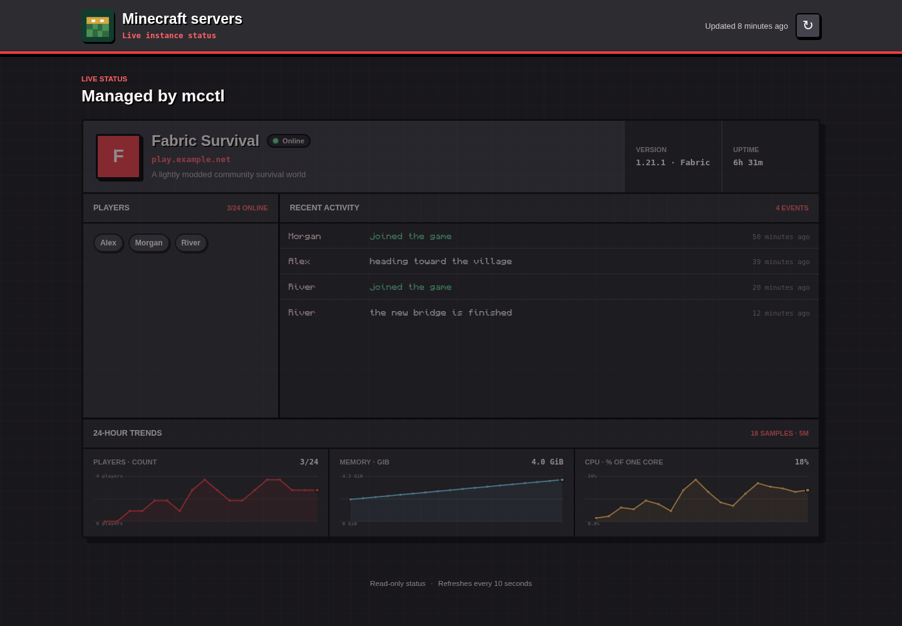

# mcctl

> **AI disclosure:** The making of this software used AI. I have been daily-driving it myself for a while and consider it stable, but if you are opposed to AI, you should not use it.

`mcctl` is an early-stage Minecraft server instance manager for Linux hosts using
systemd. It resolves Vanilla, Fabric, Forge, and NeoForge releases, verifies
downloads, selects the required Java runtime, and creates isolated server
directories under `/srv/minecraft`.

The project is early-stage and host-oriented. Its command and manifest formats
may change before a 1.0 release.

## Features

- Downloads and configures specified Vanilla, Fabric, Forge, or NeoForge
	versions, including pinned loader versions.
- Adopts existing modpacks and custom launchers into managed instances.
- Runs each server through a generic systemd/tmux service with console access,
	health checks, and operational status.
- Adds an optional per-instance Minecraft–Discord chat bridge.
- Offers an optional read-only status dashboard with activity and player views.

`mcctl` installs Minecraft and its loader only. It does not install arbitrary
mods or modpacks.

## Requirements

- Linux with systemd
- Node.js 22 or newer
- Bash, tmux, sudo, util-linux (`runuser`), and GNU coreutils
- Java runtimes appropriate for the Minecraft versions being hosted

The installer creates a locked `minecraft` system account and matching group
when absent. If the account already exists, it prints its UID, GID, home, and
shell, warns that it will be reused unchanged, and continues. The installer
validates other prerequisites but never installs packages. `/srv/minecraft` is
owned by root so the service account cannot create or replace instance roots;
individual instance directories remain owned by `minecraft`.

## Install

Install the core server manager from release `v0.1.0`:

```bash
curl -fsSL https://raw.githubusercontent.com/rozalily/mcctl/v0.1.0/bootstrap.sh | sudo bash
```

```bash
wget -qO- https://raw.githubusercontent.com/rozalily/mcctl/v0.1.0/bootstrap.sh | sudo bash
```

The bootstrap downloads the source archive into a temporary directory, validates
the required installer files, runs `install.sh`, and removes the download.

To install from a clone, review the scripts, then run:

```bash
sudo ./install.sh
```

The installer places the CLI under `/usr/local/libexec/mcctl`, installs
`/usr/local/bin/mcctl`, registers `minecraft@.service`, and installs Bash
completion. Set `MCCTL_NODE=/absolute/path/to/node` when invoking `mcctl` if
Node is not available on the normal shell `PATH`.

### Optional Dashboard

The core installer does not install the dashboard. Add it later by rerunning the
same tagged bootstrap with `--with-dashboard`, then configure and start it:

```bash
curl -fsSL https://raw.githubusercontent.com/rozalily/mcctl/v0.1.0/bootstrap.sh | sudo bash -s -- --with-dashboard
sudoedit /etc/default/mcctl-dashboard
sudo systemctl enable --now mcctl-dashboard.service
```

The dashboard binds to `127.0.0.1:3010` under `/status/`, records rolling
history under `/var/lib/mcctl-dashboard`, and runs as the `minecraft` account.
It should be exposed only through an authenticated reverse proxy. See
`dashboard/README.md` for configuration, legacy-server support, and an nginx
example.



## Usage

```bash
# Download, verify, and configure a Fabric server
mcctl create fabric-test 1.21.1-fabric --port 25566 --memory 4G

# EULA acceptance is always explicit
mcctl eula fabric-test --accept
mcctl doctor fabric-test
mcctl enable fabric-test --now
```

For a modpack or custom launcher, create an empty draft, place its files under
`/srv/minecraft/fabric-test`, then adopt it:

```bash
mcctl create fabric-test
mcctl adopt fabric-test --launch ./start.sh --port 25566 --memory 4G
```

### Discord Chat Bridge

The optional bridge directly connects an instance to one Discord text channel.
It uses Discord REST polling and opens no inbound command port.

1. [Create a Discord application and bot](https://discord.com/developers/docs/quick-start/getting-started),
   copy its bot token, and enable **Server Members Intent** on the Bot page.
2. Invite the bot to your server with View Channel, Read Message History, and
   Send Messages permissions.
3. Enable Discord Developer Mode and
   [copy the target channel ID](https://support.discord.com/hc/en-us/articles/206346498).
4. Create a private token file and open it in your editor. Put the token alone
	on one line, save, and close the editor:

```bash
install -m 600 /dev/null ~/mcctl-discord.token
${EDITOR:-vi} ~/mcctl-discord.token
```

The file should contain only:

```text
PASTE_YOUR_DISCORD_BOT_TOKEN_HERE
```

Configure the bridge using that file and the copied numeric channel ID:

```bash
mcctl bridge fabric-test --enable \
	--channel 123456789012345678 \
	--token-file ~/mcctl-discord.token \
	--command-style tellraw
rm -f ~/mcctl-discord.token
mcctl restart fabric-test
```

Here, **modern** means Minecraft Java 1.7.2 or newer, where `/tellraw` exists;
**legacy** means Java 1.7.1 or older, including Beta 1.7.3. Command styles are
configured per instance:

- `tellraw` — modern servers, with exact Discord role colors.
- `say` — unmodified legacy servers, with plain chat formatting.
- `broadcast` — legacy Bukkit/CraftBukkit, with direct role-colored chat.

The bridge also handles custom emoji, readable attachments, word wrapping on
legacy clients, and individual Discord pings. Mass and role pings stay disabled.

Run `mcctl bridge fabric-test` to inspect the current configuration. Any bridge
config change takes effect after `mcctl restart fabric-test`. Lifecycle messages
are enabled by default; use `--no-announce` or `--announce` to change them.
Disable relay without deleting its channel/token configuration with:

```bash
mcctl bridge fabric-test --disable
mcctl restart fabric-test
```

mcctl copies the token into `/etc/mcctl/bridges/fabric-test.token`; never place
it directly on the command line or in an instance manifest.

Useful operations:

```bash
mcctl resolve latest-fabric
mcctl list
mcctl status fabric-test
mcctl restart fabric-test
mcctl console fabric-test
mcctl stop fabric-test
mcctl disable fabric-test --now
```

Only directories with valid root-owned metadata in
`/etc/mcctl/instances/<name>.json` are listed or managed. For an existing manual
setup, create an empty instance, copy its files into that directory, then run
`mcctl adopt` to record its launcher and settings.

## Safety Model

Downloads stream into a temporary directory. When publishers provide SHA-1,
mcctl verifies it before installation; every artifact also receives a recorded
SHA-256. The final instance path appears only after setup succeeds. Instance
names and adopted launch paths are validated, and service startup is blocked
when doctor checks or EULA state fail.

Trusted manifests are atomically written under `/etc/mcctl/instances`, outside
the service account's writable tree. Java probes, loader installers, and writes
to mutable server files run as `minecraft`; root is retained only for trusted
metadata, ownership setup, and systemd operations.

Java and OS packages are never installed automatically. Missing runtimes stop
the operation with a package recommendation.

## Development

```bash
npm test
bash -n mcctl install.sh completions/mcctl.bash minecraft-*
```

Tests use Node's built-in test runner and deterministic HTTP/command fakes. No
runtime npm dependencies are required.

## Releases

Releases use immutable `vMAJOR.MINOR.PATCH` tags. Version bumps are manual: update
the versions in `package.json`, `dashboard/package.json`, and
`dashboard/package-lock.json`; update the default ref in `bootstrap.sh`; and
replace the pinned tag in the README install commands. Then run the full tests,
commit those changes, create an annotated tag, and push both the commit and tag.
Do not move an existing release tag.

## Roadmap

- Configurable users, paths, and service names
- Backup timers and restore workflows
- Atomic upgrades and rollback
- Paper and Quilt resolvers
- Archive import with traversal-safe extraction
- Distribution packaging and a stable manifest schema
